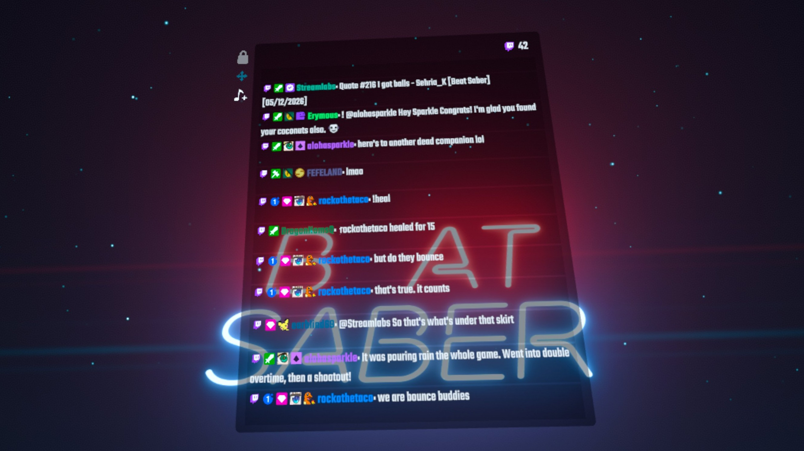

# StandaloneStreamChat

A free Twitch, YouTube, and Kick stream chat mod for Beat Saber on Quest, packaged as
a `.qmod`. Currently offered for Quest versions 1.40.8 and 1.45.3

StandaloneStreamChat is inspired by BeatSaberPlus and EnhancedStreamChat. See [Credits](#credits) and [THIRD-PARTY-NOTICES](THIRD-PARTY-NOTICES) for more information.

> **AI NOTICE**: This mod was made with the use of AI (Claude and Codex) and was **extensively checked and tested** before being released! Because this mod was made with the use of AI, *StandaloneStreamChat is not affiliated with BSMG (Beat Saber Modding Group) or BeatMods.* If you do not mind this disclaimer, here are the features of the mod:

## Features

*Screenshot of the mod's chat window on quest version 1.40.8. Chat is from one of sehria_k's livestreams since I wasnt streaming myself...*

- Twitch, YouTube, and Kick chat with live viewer counts and platform icons.
- Inline emotes and badges, including BTTV, FFZ, and 7TV emotes.
- Optional animated emotes, off by default to conserve Quest memory.
- BeatSaver song requests through `!bsr <key>`, with an accept/deny queue, map downloads, and song selection.

  *^ Note: If you have a gazillion songs downloaded (like 1000+...), it might take a little bit to load after installation due to songcore reloading your entire song library. Requested songs that are already installed will load much quicker!*
- Request cooldowns, duplicate controls, and an optional persistent queue.
- Message deletion updates, deleted-message markers, and mention highlights.
- A movable, lockable panel with adjustable size, curvature, background color, opacity, and text size.

To connect to your chat, visit the `Connections` tab in the mod settings. Platforms can also be enabled and disabled here.

## Upgrading from 0.9.x

Version 0.10.0 changes the mod's ID from `SimpleBSStreamChat` to `StandaloneStreamChat`, so ModsBeforeFriday installs it as a separate mod instead of upgrading the old one. Remove the old SimpleBSStreamChat entry after installing. If both are installed, the chat panel shows a reminder. Your settings and saved request queue are copied over the first time the new version starts.

## Credits

StandaloneStreamChat builds on the work of the following projects and contributors:

### Inspiration and feature references

- **[BeatSaberPlus](https://github.com/hardcpp/BeatSaberPlus), by HardCPP:**
  its chat and Song Requests workflows informed the comparison and improvements
  to request installation, queue handling, and map selection. The specific
  adapted filtering code comes from QuestChatPlexSDK-BS, credited below.
- **[EnhancedStreamChat](https://github.com/brian91292/EnhancedStreamChat), by brian91292:**
  served as a behavior reference for moderation updates, deleted-message
  placeholders, badges, Bits information, mention highlights, and animated
  emotes. Its C# rendering and animation implementations were not imported
  into the Standalone chat improvements.
- **[CatCore](https://github.com/ErisApps/CatCore), by ErisApps and contributors:**
  provided a reference for Twitch IRC protocol handling.
- **[SongDownloader](https://github.com/darknight1050/SongDownloader), by darknight1050 and contributors:**
  provided references for map downloading and installation-folder naming.

### Adapted source code

- **[QuestChatPlexSDK-BS](https://github.com/hardcpp/QuestChatPlexSDK-BS), by HardCPP:**
  the All Songs category-switching and exact-level-ID filtering in
  `src/Songs/LevelNavigator.cpp` adapt the SDK's `LevelSelection.cpp`
  implementation from v6.4.5. Its non-overwriting installation logic was also
  consulted when improving destination handling. The upstream MIT notice is
  retained in [LICENSE.QuestChatPlexSDK-BS](licenses/LICENSE.QuestChatPlexSDK-BS).
- **[Quest-BSML](https://github.com/bsq-ports/Quest-BSML), by RedBrumbler and contributors:**
  provides the markup, controls, and floating-screen components used by the
  panel and settings UI. Panel grab/movement math in `src/UI/ChatPanel.cpp`
  follows its `FloatingScreenHandle` implementation. Attribution and the
  unverified upstream license status are recorded in
  [NOTICE.Quest-BSML](licenses/NOTICE.Quest-BSML).
- **[MetaCoreBS](https://github.com/Metalit/MetaCoreBS), by Metalit and contributors:**
  the sequence for opening Solo with a selected song in
  `src/Songs/LevelNavigator.cpp` follows `MetaCore::Songs::SelectLevel`.
  Attribution and the unverified upstream license status are recorded in
  [NOTICE.MetaCoreBS](licenses/NOTICE.MetaCoreBS).

### Quest libraries and development tools

- **[SongCore](https://github.com/raineaeternal/Quest-SongCore):**
  loads and discovers custom maps, resolves requested maps by hash, and
  refreshes the custom-song library after installation.
- **[UnicodeQuest](https://github.com/Metalit/UnicodeQuest), by Metalit:**
  supplies Unicode font support used to display emoji.
- **[beatsaber-hook](https://github.com/QuestPackageManager/beatsaber-hook):**
  provides the native hook infrastructure used to initialize the panel from
  Beat Saber's menu lifecycle.
- **[custom-types](https://github.com/QuestPackageManager/Il2CppQuestTypePatching):**
  registers the mod's custom Unity/IL2CPP components, including chat rows,
  request rows, and settings hosts.
- **[paperlog](https://github.com/Fernthedev/paperlog):**
  provides structured logging for connection, download, and runtime diagnostics.
- **[Scotland2](https://github.com/sc2ad/scotland2):**
  loads the native Quest mod and provides its loader lifecycle.
- **bs-cordl and the [QuestPackageManager](https://github.com/QuestPackageManager) contributors:**
  provide C++ bindings for Beat Saber's IL2CPP types and the dependency/build
  tooling used by both supported game-version targets.

### Bundled third-party libraries

These libraries or their headers are compiled into the mod. Their individual
license files are included inside the QMOD and alongside it in release ZIPs.

| Library | Contribution | License text |
| --- | --- | --- |
| [libcurl](https://curl.se/) 8.5.0 | HTTP transfers and the connection transport used by the chat clients and map downloader. | [curl license](licenses/LICENSE.libcurl) |
| [OpenSSL](https://www.openssl.org/) 1.1.1w | TLS support within the bundled libcurl build. | [OpenSSL and SSLeay licenses](licenses/LICENSE.OpenSSL) |
| [RapidJSON](https://github.com/Tencent/rapidjson) | JSON parsing and serialization for provider responses, settings, and request storage. | [Upstream notices](licenses/LICENSE.RapidJSON) |
| [fmt](https://github.com/fmtlib/fmt) | Text formatting used throughout the native implementation. | [MIT license and exception](licenses/LICENSE.fmt) |
| [utfcpp](https://github.com/nemtrif/utfcpp), by Nemanja Trifunovic and contributors | UTF-8 utilities supplied through the logging dependency. | [Boost Software License](licenses/LICENSE.utfcpp) |
| [And64InlineHook](https://github.com/Rprop/And64InlineHook), by Rprop | Inline hooking compiled into the 1.40.8 build. | [MIT notice from the compiled source](licenses/LICENSE.And64InlineHook) |

### Services and community content

[BeatSaver](https://beatsaver.com/) and its map creators supply the metadata
and custom maps used by Song Requests. Emote and badge images come from their
respective platforms and the BTTV, FFZ, and 7TV communities.

StandaloneStreamChat code is [MIT-0](LICENSE) licensed. Third-party code retains its upstream
terms. Full attribution, source provenance, and licensing status are documented
in [THIRD-PARTY-NOTICES](THIRD-PARTY-NOTICES) and [licenses/](licenses/).
